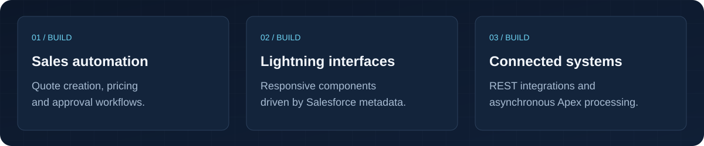

<!-- Upload this folder's contents to the public Akshayy-18/Akshayy-18 repository. -->

  

---

## About

Hey, I’m Akshay 👋

I build Salesforce applications that connect business processes, people, and data.

At Cognizant, I work on **Sales Cloud, Apex, and Lightning Web Components**, turning business requirements into practical sales automation—from quote creation and dynamic pricing to multilevel approvals and production delivery.

I enjoy building interfaces that adapt as requirements change, automating repetitive work, and keeping business logic maintainable.

[LinkedIn](https://www.linkedin.com/in/akshay-s-6a8686395) · [Email](mailto:sankarakshay08@gmail.com)

---

## What I Build

  

---

## Stack

  

---

## Salesforce in Enterprise Sales

Experience delivering **Salesforce Offer Management and sales automation** across US and Iberia regions. My work spans bulkified Apex, asynchronous processing, Lightning interfaces, role-based security, UAT, and deployments with Git and Copado.

`Sales Cloud` · `Apex & Flows` · `Lightning Web Components` · `Approval Processes`

`REST APIs` · `Data Migration` · `UAT` · `Production Support`

### From Opportunity to Offer

`Opportunity` → `Quote Creation` → `Dynamic Pricing` → `Approvals` → `Offer`

---

## Selected Work

### Salesforce Offer Management

Automated quote creation, dynamic pricing, and multilevel approvals for sales teams across US and Iberia regions. Developed bulkified Apex business logic and Lightning interfaces, and supported requirements, UAT, deployment, and production operations.

**Built with:** Apex · Flows · Lightning Components · Sales Cloud

### Metadata-driven Lightning UI

Developed Lightning Web Components that adapt to Salesforce object schema and record types, reducing hardcoded configuration and making interfaces easier to maintain.

**Built with:** Lightning Web Components · Object Schema · Record Types

### Bank Management System

Built a Salesforce application during my Cognizant internship covering customer onboarding, transactions, and loan processing. Automated banking workflows, integrated external systems through REST APIs, and migrated data using Data Loader.

**Built with:** Salesforce · Apex · Flows · REST APIs · Postman

These highlights describe professional and internship contributions. Employer source code and internal data are not published here.

---

## Certifications

- Salesforce Certified Administrator
- Salesforce Certified Platform Developer I
- Salesforce Certified Sales Cloud Consultant
- Salesforce Certified AI Specialist

---

## Connect

  <a href="https://github.com/Akshayy-18">GitHub</a>
  &nbsp; · &nbsp;
  <a href="https://www.linkedin.com/in/akshay-s-6a8686395">LinkedIn</a>
  &nbsp; · &nbsp;
  <a href="mailto:sankarakshay08@gmail.com">Email</a>

